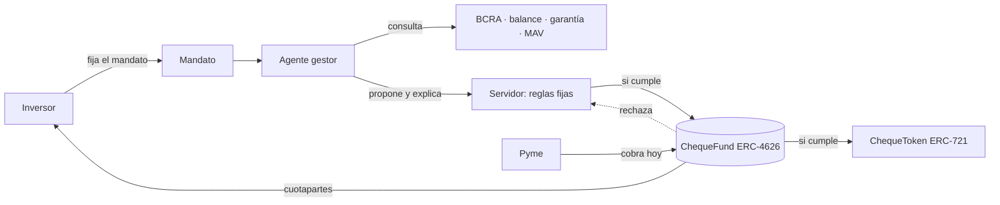

<div align="center">

# onCheck

### El cheque, a la vista.

**Un fondo de cheques y pagarés de pymes donde cada activo es un registro público, las reglas las hace cumplir el contrato y un agente invierte con el mandato que fija el inversor.**

[**Demo en vivo → on-check.vercel.app**](https://on-check.vercel.app) · [Mandato](https://on-check.vercel.app/mandato) · [Fondo](https://on-check.vercel.app/invertir) · [Pyme](https://on-check.vercel.app/pyme)

`Base Sepolia` · `ERC-4626` · `Next.js 16` · `viem` · `Foundry`

<sub>Prototipo en testnet. Sin dinero real. No es oferta pública ni asesoramiento financiero.</sub>

</div>

---

## El problema

Una pyme le vende a una gran empresa y cobra a 90 días. Si ninguna SGR le avala el cheque, nadie se lo descuenta, o se lo descuentan a una tasa que puede superar el 100 % anual. Del otro lado, el ahorrista no ve en qué está su plata.

El MAV movió **$16,8 billones en el primer semestre de 2026**, un récord. En el medio queda la pyme sin aval.

## La propuesta

onCheck compra **cheques electrónicos y pagarés** de pymes con fondos de inversores, y lo hace de una forma que se puede verificar:

| | |
|---|---|
| **Miramos al que paga** | El analista evalúa al librador con la Central de Deudores del BCRA, su balance y la industria. Si hay garantía prendaria, también la analiza. |
| **Cada activo es público** | Cada cheque o pagaré es un registro onchain y un token ERC-721. Cada decisión queda con su explicación. |
| **Las reglas están en el contrato** | Máximo 10 % del patrimonio en un emisor, 25 % en una industria, 15 % de liquidez mínima, KYC para invertir. No dependen de que confíes en nosotros. |
| **El inversor fija su mandato** | Presupuesto, banda de riesgo, tope por emisor, plazo y cobertura de garantía. Un botón, y el agente compra. Se puede pausar o revocar. |
| **La pyme cobra hoy** | El fondo paga en la misma operación y la pyme ve el costo antes de aceptar. |

El agente **propone y explica**. No decide: lo que se pasa de las reglas del mandato o del fondo lo frena el servidor y, antes que él, el contrato.

## Cómo funciona



1. **La pyme** sube un cheque o pagaré y recibe una cotización firmada.
2. **El agente** analiza al librador (BCRA, balance, industria) y la garantía, y emite una decisión con su fundamento.
3. **El servidor** aplica 11 reglas fijas del mandato y los límites del fondo. Solo lo que pasa se envía.
4. **El contrato** vuelve a aplicar las reglas del fondo. Si algo no cumple, la transacción se revierte.
5. **El inversor** entra desde 1.000 cuotapartes, rescata en 24 horas hábiles y ve en qué está cada peso.

## Reglas del fondo (on-chain)

| Regla | Valor |
|---|---|
| Concentración por emisor | 10 % del patrimonio |
| Concentración por industria | 25 % del patrimonio |
| Liquidez mínima | 15 % |
| Precio inicial de la cuotaparte | $1.000 |
| Mínimo de entrada | 1.000 cuotapartes, de a 1 |
| Comisión de gestión | 3 % anual sobre el patrimonio, devengada día a día |
| Rescate | 24 horas hábiles, corte 15 hs (Buenos Aires) |
| Objetivo de retorno | 40 % anual. Es un objetivo, no una promesa |

## El Mandato

El inversor define sus reglas una vez en [`/mandato`](https://on-check.vercel.app/mandato): presupuesto, banda de riesgo crediticio, tope por emisor, plazo máximo y cobertura mínima de garantía. El agente recorre una bandeja de activos en paralelo, evalúa cada uno contra las 11 reglas y ejecuta en orden.

- Cada compra viene con sus razones en castellano ("cumple 11 de 11").
- Lo que el mandato permite pero el fondo no, lo frena el límite del fondo, y el agente lo anota y sigue.
- Si un emisor rebota, el agente deja de comprarle, registra la pérdida y la cuotaparte la refleja. La pérdida es pública.
- Al final, un informe: antes y después, qué compró, qué omitió, qué se rechazó, con los links al explorer.

Especificación completa: [`docs/MANDATO-SPEC.md`](docs/MANDATO-SPEC.md).

## Evidencia onchain

| Qué | Dónde |
|---|---|
| **Fondo v2 en Base Sepolia** | [`ChequeFund`](https://sepolia.basescan.org/address/0x92108330eC68551d448711c4Fb725662fB1EB973) · [`ChequeToken`](https://sepolia.basescan.org/address/0x149d3ebBe80B09b698563E0a9AD67186744aE5E5) · [`MockARGt`](https://sepolia.basescan.org/address/0x68F8e16dee32004B27619dE3e65d518c9C295371) |
| **Pago con ARGt real (Twin) en Arbitrum One** | [`0xd2d1…29a9`](https://arbiscan.io/tx/0xd2d1a142027dd4ebdbadac7aefe833c24bc790c4a28bd9443e4fea21128429a9): 10 ARGt, ejecutado por la pantalla [`/argt-real`](https://on-check.vercel.app/argt-real). Detalle y capturas en [`docs/evidencia-onchain`](docs/evidencia-onchain/README.md) |
| **Fondo en Avalanche Fuji** | Desplegado y verificado, operado desde [`/avalanche`](https://on-check.vercel.app/avalanche). Por qué Avalanche: [`docs/WHY-AVALANCHE.md`](docs/WHY-AVALANCHE.md) |

## Qué es real y qué es simulado

Decirlo claro es parte del producto.

- **Real:** los contratos, las transacciones, las reglas, la lectura de la Central de Deudores del BCRA, el análisis del agente y el pago de 10 ARGt en Arbitrum One.
- **Simulado en la demo:** el MAV, el rebote de un emisor, la liquidez en cuenta remunerada y el ARGt del fondo de testnet (`MockARGt`).
- **No incluido:** la prenda legal (se firma después), custodia regulada y el vehículo regulatorio. El camino es sandbox CNV, un vehículo regulado y un socio licenciado.

## Estructura del repositorio

```
contracts/    Solidity (Foundry, OpenZeppelin 5): ChequeFund, ChequeToken, MockARGt
src/app/      Pantallas y API (Next.js App Router)
src/lib/      Agente, mandato, scoring BCRA, garantías, capa chain (viem)
shared/       ABI, fixtures y direcciones desplegadas
scripts/      Preparación y verificación del despliegue
docs/         Especificaciones, decisiones, guiones y evidencia
```

## Correrlo en local

Requisitos: Node 20+, pnpm, y [Foundry](https://book.getfoundry.sh) para contratos.

```bash
pnpm install
pnpm dev            # http://localhost:3000, con datos de prueba si no hay contrato
```

Para operar contra contratos reales, copiá las variables de [`docs/DEPLOY-WEB.md`](docs/DEPLOY-WEB.md). Las claves de las wallets viven solo del lado del servidor y nunca se imprimen.

```bash
pnpm test           # tests de la app (Vitest)
pnpm typecheck      # TypeScript estricto
cd contracts && forge test   # tests de contratos
pnpm demo:preparar <URL> --solo-pool   # deja una copia lista para la demo
```

## Documentación

Índice completo en [`docs/README.md`](docs/README.md). Los puntos de entrada:

- [`docs/SPEC.md`](docs/SPEC.md) y [`docs/V2-SPEC.md`](docs/V2-SPEC.md): qué hace el producto y por qué.
- [`docs/MANDATO-SPEC.md`](docs/MANDATO-SPEC.md): el agente con mandato.
- [`docs/DECISIONS.md`](docs/DECISIONS.md): decisiones cerradas.
- [`docs/DEMO-SCRIPT-BELO.md`](docs/DEMO-SCRIPT-BELO.md): guion de la demo.
- [`docs/BUILD-LOG.md`](docs/BUILD-LOG.md): cronología del proyecto, qué se hizo y cuándo.

## Stack

Solidity 0.8.28 · Foundry · OpenZeppelin 5 · Next.js 16 · React 19 · TypeScript · Tailwind 4 · viem 2 · Vitest · pnpm · Base Sepolia · Arbitrum One · Avalanche Fuji · Vercel

## Equipo

**On-Chain**, HackaTwin 2026 (7 de noviembre de 2026, Digital House): Joaquín ([`joacolasca`](https://github.com/joacolasca)), Rama ([`Rameik`](https://github.com/Rameik)), Nacho ([`nachopalmeri`](https://github.com/nachopalmeri)) y Facu.

<sub>Prototipo en testnet: nada de lo que muestra es una oferta de inversión.</sub>
